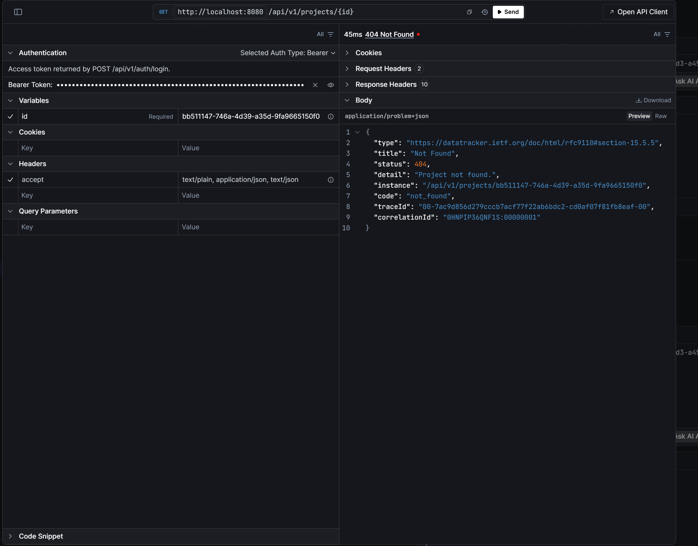
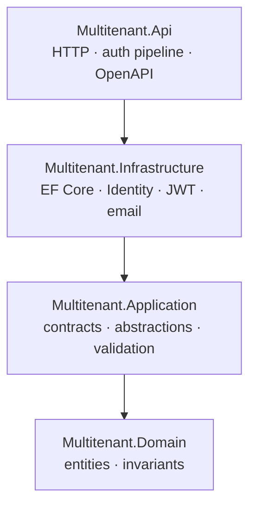
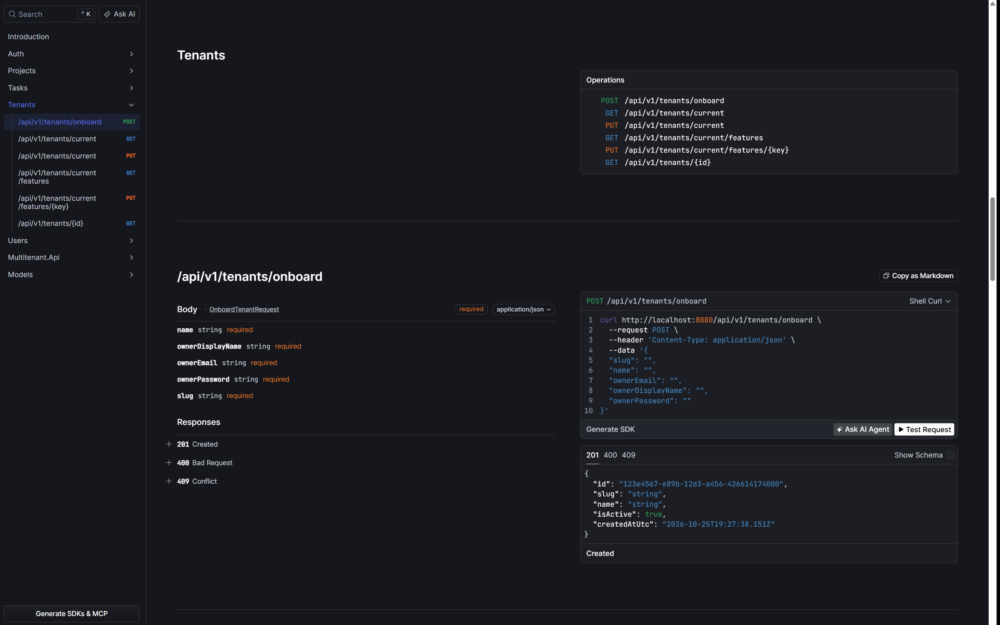

# Multitenant SaaS API


A production-minded, multi-tenant SaaS backend on ASP.NET Core 10, EF Core 10 and PostgreSQL 16:
tenant isolation enforced in depth, JWT authentication with rotating refresh tokens, role-based
authorization, transactional onboarding, rate limiting, health checks, OpenAPI, structured
logging and a real integration-test suite.

The domain is deliberately small — tenants, users, projects, tasks — so the interesting work is
visible in the platform: how isolation is enforced, how auth behaves under change, and how all
of it is tested and operated.

---

## Demo: the isolation proof, in one request



*Authenticated as the `globex` owner and requesting a project that belongs to `acme`: the API
returns `404` and never confirms that the resource exists in another tenant.*

Start the seeded stack (see [Quick start](#quick-start)), then create a project as the owner of
`acme` and ask for that same id as the owner of `globex`:

```bash
# 1. Create a project as the acme owner. Note the id in the response.
curl -s http://localhost:5270/api/v1/projects \
  -H "Authorization: Bearer <acme-access-token>" \
  -H "Content-Type: application/json" \
  -d '{"name":"Acme Rocket","status":"Active"}'
# 201 Created
# {"id":"8f3cff21-...","name":"Acme Rocket","status":"Active", ...}

# 2. Ask for the same project as the globex owner.
curl -s http://localhost:5270/api/v1/projects/8f3cff21-... \
  -H "Authorization: Bearer <globex-access-token>"
```

```json
{
  "type": "https://datatracker.ietf.org/doc/html/rfc9110#section-15.5.5",
  "title": "Not Found",
  "status": 404,
  "detail": "Project not found.",
  "instance": "/api/v1/projects/8f3cff21-...",
  "code": "not_found",
  "traceId": "00-35376aacd73ad8078b53a4d832ad1e0d-28dc0d7b8f93279d-00",
  "correlationId": "0HNPIOTPBJO33:00000004"
}
```

`acme` gets `200` for the very same id, `globex` gets `404` — never `403`, so the response does
not confirm the project exists in another tenant. That behaviour is enforced by the EF Core
query filters, the write interceptor and composite foreign keys, and it is locked down by
`TenantIsolationTests`:

```bash
dotnet test tests/Multitenant.IntegrationTests --filter "FullyQualifiedName~TenantIsolation"
```

---

## Contents

1. [Demo](#demo-the-isolation-proof-in-one-request)
2. [What this project demonstrates](#what-this-project-demonstrates)
3. [Quick start](#quick-start)
4. [Security model](#security-model)
5. [Architecture](#architecture)
6. [API reference](#api-reference)
7. [Configuration](#configuration)
8. [Testing](#testing)
9. [Operations](#operations)
10. [Design decisions](#design-decisions)
11. [Repository layout](#repository-layout)
12. [Known limitations and roadmap](#known-limitations-and-roadmap)
13. [How this was built](#how-this-was-built)
14. [Licence](#licence)

---

## What this project demonstrates

| Capability | Where |
| --- | --- |
| Tenant isolation enforced at five layers, including the database | [Security model](#security-model), [ADR 0003](docs/adr/0003-tenant-isolation.md), `TenantIsolationTests` |
| ASP.NET Core Identity + custom JWT flow, live token invalidation | [ADR 0004](docs/adr/0004-identity-and-tokens.md), `AuthService` |
| Refresh-token rotation with theft (reuse) detection | `RefreshTokenManager`, `AuthLifecycleTests` |
| Policy-based authorization with a three-role hierarchy | `Policies`, `AuthorizationRulesTests` |
| EF Core global query filters, composite keys, interceptors, one squashed migration | `Persistence/` |
| RFC 7807 error modelling with stable machine codes | `GlobalExceptionHandler`, `ProblemDetailsStatusCodePages` |
| Per-tenant and per-IP rate limiting | [ADR 0006](docs/adr/0006-rate-limiting.md), `RateLimitingSetup` |
| Per-tenant feature flags with whitelisted keys | [ADR 0009](docs/adr/0009-per-tenant-feature-flags.md), `TenantFeatureTests` |
| Tenant rename with an immutable login slug | [ADR 0010](docs/adr/0010-tenant-lifecycle-scope.md), `TenantManagementTests` |
| FluentValidation, fail-closed at startup | `Validation/`, `ValidationFilterAssertion` |
| 104 tests: 40 unit + 64 integration, Testcontainers against real PostgreSQL | [Testing](#testing) |
| Clean layering, one-way dependencies, no business logic in controllers | [ADR 0002](docs/adr/0002-layered-solution.md) |
| Docker multi-stage image, compose stack, CI publishing to GHCR | [Operations](#operations), `.github/workflows/ci.yml` |
| Correlation ids, Serilog JSON logging, optional App Insights | [ADR 0007](docs/adr/0007-observability.md) |

The code favours explicit, readable implementations over clever abstractions, and every
non-obvious decision is written down as an ADR.

---

## Quick start

### Prerequisites

- [.NET SDK 10.0.4xx](global.json) (pinned to `10.0.401`, `rollForward: latestFeature`)
- Docker Desktop (or any PostgreSQL 16 you own)
- Optional: `dotnet-ef` (`dotnet tool install --global dotnet-ef --version 10.*`)

### Run it locally (recommended)

```bash
# 1. One-time: create .env with a real signing key (compose requires it for every command)
cp .env.example .env
openssl rand -base64 48          # paste into JWT_SIGNING_KEY
#   Windows alternative:
#   $b = New-Object byte[] 48; [Security.Cryptography.RandomNumberGenerator]::Create().GetBytes($b)
#   [Convert]::ToBase64String($b)

# 2. Start PostgreSQL only — loopback-bound, data persists in the postgres-data volume
docker compose up -d postgres

# 3. Run the API — it creates the database, applies migrations and seeds demo data
dotnet run --project src/Multitenant.Api --launch-profile http
```

Then open <http://localhost:5270/scalar> and log in as `owner@acme.test` / `Demo123!Passw0rd`.

What happens on first start:

- `src/Multitenant.Api/appsettings.Development.json` (git-ignored, see
  [Configuration](#configuration)) supplies the connection string — the same credentials as the
  compose container, so Docker and `dotnet run` share one database.
- `Database:AutoMigrate=true` applies the single squashed `InitialCreate` migration (creating
  the database if it does not exist).
- `Database:SeedDemoData=true` + `Demo:Password` insert the demo tenants once; later starts
  detect the existing slugs and leave them untouched.
- Subsequent runs reuse exactly the same database and data. `docker compose down -v` is the
  only command that discards it.

### Run everything in Docker

```bash
cp .env.example .env       # edit JWT_SIGNING_KEY and passwords
docker compose up --build
```

The API waits for PostgreSQL, then listens on <http://localhost:8080> (Scalar at
<http://localhost:8080/scalar>). Demo seeding is opt-in: set `SEED_DEMO_DATA=true` and
`DEMO_PASSWORD=<your password>` in `.env`. Without them the database starts clean and the
first tenant is created with `POST /api/v1/tenants/onboard`.

### Demo accounts

Only created when demo seeding is explicitly enabled — startup fails if the seed is requested
without a password, and there is no built-in default, so a stack started without these settings
has no known-credential accounts. Both tenants use the configured `Demo:Password`:

| Tenant | Email | Role |
| --- | --- | --- |
| `acme` | `owner@acme.test` | Owner |
| `acme` | `member@acme.test` | Member |
| `globex` | `owner@globex.test` | Owner |
| `globex` | `member@globex.test` | Member |

### Smoke test

```bash
# Log in
curl -s http://localhost:5270/api/v1/auth/login \
  -H "Content-Type: application/json" \
  -d '{"tenantSlug":"acme","email":"owner@acme.test","password":"Demo123!Passw0rd"}'

# Read the tenant resolved from the token
curl -s http://localhost:5270/api/v1/tenants/current \
  -H "Authorization: Bearer <access-token>"

# Onboard a brand-new tenant in one transaction
curl -s http://localhost:5270/api/v1/tenants/onboard \
  -H "Content-Type: application/json" \
  -d '{"slug":"initech","name":"Initech","ownerEmail":"owner@initech.test","ownerDisplayName":"Initech Owner","ownerPassword":"Password1!aaaa"}'
```

---

## Security model

### Tenant isolation, in depth

One database, many tenants. No single layer is trusted to be the only one:

1. **The tenant is never a client input for authenticated calls.** `JwtBearerConfiguration`
   reads `tenant_id` from the validated token and resolves the tenant context before any
   query runs. Anonymous flows (login, refresh, onboarding) resolve it from the slug or the
   refresh token — never from a header the caller could forge.
2. **Reads are filtered.** `AppUser`, `Project` and `WorkItem` carry global EF Core query
   filters on `TenantId`, keyed off a `DbContext` property (never a captured service, which
   would freeze the first request's tenant into EF's model cache).
3. **Writes are guarded.** `TenantAuditingInterceptor` stamps the resolved tenant on inserts
   and rejects any insert, update or delete that targets a different tenant.
4. **The database itself knows about tenancy.** Composite foreign keys on `(TenantId, Id)` for
   projects and task assignees, plus `CK_WorkItems_AssigneeTenant` requiring both assignee
   columns to be set together with `AssigneeTenantId = TenantId`. The composite key is MATCH
   SIMPLE, so a NULL would otherwise skip the reference check entirely. Cross-tenant links are
   impossible even with raw SQL, not just through the API.
5. **The API hides existence.** Cross-tenant ids return `404`, never `403`, so the API does not
   confirm that a resource exists in another tenant.

Every deliberate `IgnoreQueryFilters()` call is greppable and paired with an explicit `TenantId`
predicate (login, refresh, security-stamp validation, seeding).

### Authentication and sessions

| Token | Properties |
| --- | --- |
| Access | HMAC-SHA256 JWT, 15 minutes by default (`Jwt:AccessTokenMinutes`, 1–120), 30 s clock skew. Claims: `sub`, `tenant_id`, `tenant_slug`, `email`, `name`, `role`, `sstamp`, `jti`. |
| Refresh | 256 bits of CSPRNG, URL-safe, stored only as a SHA-256 hash, 30-day lifetime, belongs to a token *family*. |

- **Live invalidation** — every authenticated request re-checks the user, the `sstamp` claim
  against the stored security stamp and the `role` claim against the current role. Role
  changes, logout-everywhere and password resets take effect immediately, not at expiry.
- **Rotation with reuse detection** — refreshing revokes the old token and issues a replacement
  in the same family. Presenting an already-revoked token is treated as theft: the whole family
  is revoked and the request fails.
- **Single session by default** — `Auth:SingleSessionPerUser=true` rotates the stamp on login
  and revokes all other refresh tokens, so only the newest session survives. Set `false` for
  multi-device use.
- **Per-tenant usernames** — `RequireUniqueEmail=false`; the same email may exist in different
  tenants, with uniqueness enforced on `(TenantId, NormalizedEmail)`.

### Identity feature flags

Both flows are fully implemented and opt-in, so local development stays frictionless:

| Setting | Default | Effect when `true` |
| --- | --- | --- |
| `Identity:RequireConfirmedEmail` | `false` | Login and refresh require a confirmed email (`403 email_not_confirmed`) |
| `Identity:EnableTwoFactor` | `false` | TOTP setup/enable/disable/verify endpoints are exposed; login issues a 2FA challenge |

Two ordering details matter:

- The confirmation check runs **after** the password succeeds, so an anonymous caller cannot
  distinguish "unconfirmed address" from "unknown address" — an enumeration oracle removed.
- Refresh applies the same check, so sessions minted while confirmation was optional cannot
  outlive the flag being switched on.

Confirmation links always work, even with the flag off: the token rides in a URL fragment, and
the `/confirm-email` page POSTs `{ "userId", "token" }` in the request body — never a query
string — so proxies, browser history and `Referer` never capture it. Resend is always `202` and
cannot be used to probe which addresses exist.

### Authorization

| Role | Capabilities |
| --- | --- |
| `Owner` | Everything: manage Owners, users, projects, tasks; last-Owner protection |
| `Admin` | Manage users (except Owners), manage projects, delete tasks |
| `Member` | Read tenant data, create and update tasks, manage own profile |

- Policies live in `Policies` (`manage_tenant`, `owner_only`, `member`); business rules such as
  "the last Owner cannot be demoted or deleted" live in `UserService`, not in controllers.
- That guard is race-proof: it runs inside a transaction holding a row lock on the tenant, so
  two concurrent demotions cannot both pass.
- `POST /auth/register` adds a `Member` to the caller's **own** tenant and requires
  Owner/Admin. Anonymous joining by slug is deliberately not supported — a slug is not a
  credential ([ADR 0008](docs/adr/0008-admin-only-registration.md)). Public sign-up, if a
  product needs it, belongs in a signed-invite or email-domain allow-list flow.
- **Feature switches are per tenant.** An Owner can turn a whitelisted capability off for their
  tenant (`task_assignment` today); a disabled capability returns `404` with a specific code, and
  a tenant with no override keeps the default (enabled) behaviour
  ([ADR 0009](docs/adr/0009-per-tenant-feature-flags.md)).

### Error contract

Every error is `application/problem+json` with a stable machine-readable `code`, plus `traceId`
and `correlationId`:

| Status | Codes (examples) | Meaning |
| --- | --- | --- |
| 400 | `validation_failed` | Request failed FluentValidation |
| 401 | `invalid_refresh_token`, `invalid_two_factor_challenge` | Bad or expired credentials |
| 403 | `email_not_confirmed`, `role_not_allowed`, `tenant_mismatch`, `self_role_change` | Authenticated but not allowed |
| 404 | `feature_disabled`, missing/foreign resource | Unknown or cross-tenant target |
| 409 | `email_taken`, `last_owner`, `slug_taken` | Conflict with existing state |
| 429 | `rate_limited` | Budget exhausted (`Retry-After` included) |

Stack traces are only returned in Development.

---

## Architecture

Four projects, one-way dependencies:



- **Domain** — entities, invariants, enums, domain errors. No framework coupling beyond the
  Identity base classes chosen for persistence.
- **Application** — what the system can do (`IAuthService`, `ITenantService`, …), the shapes
  crossing the boundary, validators and options. Knows nothing of EF Core or ASP.NET Core.
- **Infrastructure** — the only project that knows about PostgreSQL, Npgsql, Identity stores,
  SMTP and JWT signing.
- **Api** — a thin composition root: controllers translate HTTP to Application interfaces; the
  pipeline handles cross-cutting concerns. No business logic in controllers.

Request pipeline, login/validation sequence, refresh-token lifecycle, the tenant-isolation
layers and the full ER model (including the check constraint) are diagrammed in
[docs/architecture.md](docs/architecture.md).

One type per file, namespaces mirror the folder tree, mapping is hand-written (no AutoMapper),
and there is exactly one way to do each thing: one tenant context, one user-creation path
(`UserProvisioningService`), one password policy, one problem-details factory.

---

## API reference

Base path `/api/v1`. All timestamps are UTC. Versioned routes and an OpenAPI document per
version at `/openapi/v1.json`; interactive docs at `/scalar`.



### Auth

| Method | Route | Auth | Purpose |
| --- | --- | --- | --- |
| POST | `/auth/login` | anonymous, IP-limited | Password login; returns tokens or a 2FA challenge |
| POST | `/auth/register` | Owner/Admin | Add a `Member` to your own tenant (`403 tenant_mismatch` otherwise) |
| POST | `/auth/refresh` | anonymous, IP-limited | Rotate the refresh token, issue a new pair |
| POST | `/auth/logout` | bearer | Revoke one refresh token |
| POST | `/auth/logout-all` | bearer | Revoke all sessions and access tokens |
| POST | `/auth/confirm-email` | anonymous | Complete confirmation (`{ userId, token }` body) |
| POST | `/auth/resend-confirmation` | anonymous, IP-limited | Re-send the confirmation email (always `202`) |
| POST | `/auth/2fa/setup` | bearer | Create an authenticator key + `otpauth://` URI |
| POST | `/auth/2fa/enable` | bearer | Verify the first TOTP code, return recovery codes |
| POST | `/auth/2fa/disable` | bearer | Verify a code, disable 2FA |
| POST | `/auth/2fa/verify` | anonymous, IP-limited | Complete a 2FA login |

### Tenants

| Method | Route | Auth | Purpose |
| --- | --- | --- | --- |
| POST | `/tenants/onboard` | anonymous, IP-limited | Provision tenant + owner + starter data in one transaction |
| GET | `/tenants/current` | member | The tenant resolved from the token |
| PUT | `/tenants/current` | Owner | Rename the current tenant (the slug is immutable) |
| GET | `/tenants/current/features` | member | Effective per-tenant feature switches |
| PUT | `/tenants/current/features/{key}` | Owner | Enable or disable a whitelisted feature for this tenant |
| GET | `/tenants/{id}` | member | Your own tenant by id (the onboarding `Location` target); other ids → `404` |

### Users

| Method | Route | Auth | Purpose |
| --- | --- | --- | --- |
| GET | `/users/me` | member | Current profile |
| GET | `/users` | Owner/Admin | Paged list (`page`, `pageSize`, `search`, `role`, `isActive`, `sort`) |
| GET | `/users/{id}` | Owner/Admin | One user in the current tenant |
| POST | `/users` | Owner/Admin | Create a user with a chosen role (only Owners may create Owners) |
| PATCH | `/users/{id}/role` | Owner/Admin | Change a role; invalidates existing access tokens immediately |
| DELETE | `/users/{id}` | Owner/Admin | Delete a user (last-Owner protection) |

### Projects and tasks

| Method | Route | Auth | Purpose |
| --- | --- | --- | --- |
| GET | `/projects` | member | Paged list (`search`, `status`, `sort`) |
| GET | `/projects/{id}` | member | One project |
| POST | `/projects` | Owner/Admin | Create |
| PUT | `/projects/{id}` | Owner/Admin | Update |
| DELETE | `/projects/{id}` | Owner/Admin | Delete (cascades to tasks) |
| GET | `/tasks` | member | Paged list (`search`, `status`, `priority`, `projectId`, `assigneeUserId`, `dueBefore`, `dueAfter`, `sort`) |
| GET | `/tasks/{id}` | member | One task |
| GET | `/projects/{projectId}/tasks` | member | Tasks of one project |
| POST | `/projects/{projectId}/tasks` | member | Create a task (any member) |
| PUT | `/tasks/{id}` | member | Update a task |
| DELETE | `/tasks/{id}` | Owner/Admin | Delete a task |

### Platform

| Method | Route | Purpose |
| --- | --- | --- |
| GET | `/health`, `/health/live`, `/health/ready` | Anonymous health checks, exempt from rate limiting |
| GET | `/openapi/v1.json` | Versioned OpenAPI document |
| GET | `/scalar` | Interactive API docs |
| GET | `/confirm-email` | Page served for emailed confirmation links |

**Conventions.** Pagination uses `page`/`pageSize` (normalized, capped). Sorting uses `field`
for ascending and `-field` for descending, restricted to a per-resource whitelist. Search is
case-insensitive (`ILIKE`). Validation failures return `400` with a `validation_failed` code and
per-field details; startup fails if any endpoint lacks a registered validator, so validation
cannot fail open.

---

## Configuration

Standard ASP.NET Core layering: `appsettings.json` → environment `appsettings*.json` →
environment variables → (Development) user secrets. Secrets are never committed:
`appsettings.Development.json` and `.env` are git-ignored, and `Jwt:SigningKey`,
`ConnectionStrings:Postgres` and `Demo:Password` ship empty — startup validation fails fast
when a required value is missing.

| Setting | Default | Notes |
| --- | --- | --- |
| `AllowedHosts` | `localhost` | Must be explicit outside Development; startup throws on `*` |
| `ConnectionStrings:Postgres` | empty | **Required** |
| `Jwt:Issuer` / `Jwt:Audience` | `multitenant-aspnet-api` | Validated on every token |
| `Jwt:SigningKey` | empty | **Required**, minimum 32 characters |
| `Jwt:AccessTokenMinutes` | `15` | 1–120 |
| `Auth:SingleSessionPerUser` | `true` | New login/refresh invalidates older sessions |
| `Auth:RefreshTokenDays` | `30` | Refresh-token lifetime |
| `Auth:PublicBaseUrl` | `http://localhost:8080` | Builds confirmation links; must be HTTPS in production |
| `Auth:TwoFactorChallengeMinutes` | `5` | Lifetime of a 2FA challenge token |
| `Identity:RequireConfirmedEmail` | `false` | Gate login/refresh on a confirmed email |
| `Identity:EnableTwoFactor` | `false` | Expose and require TOTP |
| `Email:Provider` | `Logging` | `Logging` or `Smtp` |
| `Email:FromAddress` / `FromName` | `no-reply@multitenant.local` / `Multitenant API` | Sender identity |
| `Email:Smtp:Host` | empty | Required when the provider is `Smtp` |
| `Email:Smtp:Port` / `UseStartTls` | `587` / `true` | `false` logs a plaintext warning |
| `Email:Smtp:Username` / `Password` | empty | Optional SMTP auth |
| `RateLimiting:Tenant:PermitLimit` / `WindowSeconds` | `120` / `60` | Per-tenant budget |
| `RateLimiting:Auth:PermitLimit` / `WindowSeconds` | `10` / `60` | Per-IP budget on auth endpoints |
| `Database:AutoMigrate` | `false` | Apply migrations on startup (dev/demo) |
| `Database:SeedDemoData` | `false` | Seed roles + demo tenants; requires `Demo:Password`, fails fast without it |
| `Demo:Password` | empty | Password for seeded demo users |
| `Cors:AllowedOrigins` | `[]` | Empty disables CORS; standard headers/methods only, credentials disabled |
| `ForwardedHeaders:Enabled` | `false` | Trust proxies/ networks so rate limiting and logs see the real client IP |
| `Serilog:MinimumLevel:*` | `Information` | Standard Serilog overrides |
| `Serilog:AzureMonitor:ConnectionString` | empty | Also send logs to Application Insights |

A minimal local `appsettings.Development.json` for `dotnet run`:

```json
{
  "ConnectionStrings": { "Postgres": "Host=localhost;Port=5432;Database=multitenantDb;Username=multitenant-DbUser;Password=multitenant-DbPassword123!" },
  "Jwt": { "SigningKey": "<32+ character random string>" },
  "Demo": { "Password": "Demo123!Passw0rd" },
  "Database": { "AutoMigrate": true, "SeedDemoData": true }
}
```

These values are for local development only; production must come from a secret store.

### Migrations

The schema starts from a squashed `InitialCreate` migration covering every table, index,
alternate key and check constraint; later changes are added on top (`TenantFeatures` is the
first). Change the model, then add a migration:

```bash
dotnet ef migrations add <Name> \
  --project src/Multitenant.Infrastructure \
  --startup-project src/Multitenant.Infrastructure \
  --output-dir Persistence/Migrations

dotnet ef database update \
  --project src/Multitenant.Infrastructure \
  --startup-project src/Multitenant.Infrastructure
```

The design-time factory reads `ConnectionStrings__Postgres` from the environment, then the
API's `appsettings*.json`, then falls back to the Development connection string.

---

## Testing

**104 tests: 40 unit + 64 integration.** No mocks of the data layer and no in-memory database —
integration tests run against a real PostgreSQL 16 container (Testcontainers).

```bash
dotnet test multitenant-aspnet-api.slnx          # everything (Docker required)
dotnet test tests/Multitenant.UnitTests           # milliseconds, no infrastructure

# The isolation proof: two tenants, then 404s across the boundary
dotnet test tests/Multitenant.IntegrationTests --filter "FullyQualifiedName~TenantIsolation"
```

**Unit tests** cover domain invariants (slug and password rules), pagination/sorting including
offset overflow, claim generation, 2FA challenge validation and refresh-token hashing.

**Integration tests** boot the real API via `WebApplicationFactory` and cover:

- tenant isolation for projects, tasks and users, including cross-tenant writes;
- cross-tenant task-assignee rejection at the database level, including the NULL-column bypass;
- refresh rotation, reuse detection, family revocation, expiry and concurrent rotation;
- single-session enforcement and the multi-device path (`SingleSessionPerUser=false`);
- role-change invalidation and refreshed role claims;
- logout, logout-all, and lockout after repeated bad passwords;
- registration (admin-only, cross-tenant slug rejection), duplicate emails, the role matrix;
- email confirmation end-to-end with a captured email sender, and resend behaviour;
- two-factor enable, login challenge, single-use recovery codes and disable;
- paging, sorting, search and status/priority/date filters;
- per-tenant feature switches, including the assignment block and tenant-scoped overrides;
- tenant rename permissions and the immutable slug;
- per-IP and per-tenant rate limiting, including health-endpoint exemptions;
- startup configuration validation (JWT key, email provider, forwarded proxies);
- health checks, OpenAPI (including the bearer scheme), 404/405 handling, correlation ids
  and the problem-details shape.

Docker must be running for the integration suite. The collection fixture starts one container
per run; each test onboards tenants with unique slugs so tests never collide. The suite takes
about 20 seconds once the image is cached.

---

## Operations

### Docker

- Multi-stage `Dockerfile`, non-root `$APP_UID` user on `mcr.microsoft.com/dotnet/aspnet:10.0`,
  plain HTTP on 8080 (terminate TLS at the ingress; the app redirects to HTTPS, so
  `ForwardedHeaders` must carry the original scheme).
- `compose.yaml` binds PostgreSQL to `127.0.0.1:5432` (loopback only) and keeps data in the
  `postgres-data` volume, so local runs reuse one database without exposing it beyond the
  machine. The default database password is a development convenience — override
  `POSTGRES_PASSWORD` for anything shared.
- `JWT_SIGNING_KEY` is required by compose for **every** command (compose validates the whole
  file, even when you only start PostgreSQL). Failing fast beats starting with an empty key.

### Production checklist

- `Database:AutoMigrate=false`; run migrations as an explicit release step.
- `Database:SeedDemoData=false`.
- `AllowedHosts` set to the public host names (startup fails on `*`).
- `ConnectionStrings__Postgres` and `Jwt__SigningKey` from the platform secret store.
- `Auth:PublicBaseUrl` set to the public HTTPS URL used in confirmation links.
- `Email:Provider=Smtp` (or add a provider-specific `IEmailSender`).
- Shared Data Protection key ring (Redis, Key Vault, persistent volume) when running more
  than one replica — confirmation tokens are signed with it.
- At least two replicas behind a load balancer; note that rate-limiter state is per process
  and Data Protection keys are local until a shared ring is configured.

### CI/CD

`.github/workflows/ci.yml`:

1. **build-test** — restore, Release build, unit tests, integration tests on GitHub-hosted
   Ubuntu runners (Docker for Testcontainers), TRX artefacts uploaded.
2. **publish-image** — on pushes to `main`/`master` and `v*.*.*` tags, builds and pushes
   `ghcr.io/<owner>/<repo>` with branch, SHA, semver and `latest` (default branch) tags.

The current release is **`v1.0.1`**, which produces container tags `1.0.1` and `1.0`. No
repository secrets are required for tests; the image uses the workflow's default `GITHUB_TOKEN`
permissions (`packages: write`) or a `CR_PAT`.

### Observability

- **Correlation** — every request carries an `X-Correlation-Id` (accepted or generated,
  restricted to `[A-Za-z0-9._-]`), echoed on the response, pushed into the Serilog context and
  included in problem details alongside ASP.NET's `traceId`.
- **Request logging** — method, path, status and elapsed time per request.
- **Environments** — readable console in Development; compact JSON on stdout elsewhere, which
  is natively ingestible by CloudWatch Logs and Azure Log Analytics.
- **Application Insights** — set `Serilog:AzureMonitor:ConnectionString` and events also flow
  to App Insights (KQL-queryable in Azure Monitor).
- **Errors** — handled exceptions log at Warning, unhandled at Error, never with a client-side
  stack trace outside Development.

---

## Design decisions

| ADR | Decision |
| --- | --- |
| [0001](docs/adr/0001-record-architecture-decisions.md) | Record architecture decisions, kept current |
| [0002](docs/adr/0002-layered-solution.md) | Layered solution with a thin API |
| [0003](docs/adr/0003-tenant-isolation.md) | Tenant isolation in one database |
| [0004](docs/adr/0004-identity-and-tokens.md) | Identity with custom JWTs and rotating refresh tokens |
| [0005](docs/adr/0005-identity-feature-flags.md) | Email confirmation and 2FA are opt-in |
| [0006](docs/adr/0006-rate-limiting.md) | Per-tenant rate limiting with the built-in limiter |
| [0007](docs/adr/0007-observability.md) | Structured logging and RFC 7807 errors |
| [0008](docs/adr/0008-admin-only-registration.md) | Registration is a tenant-admin action |
| [0009](docs/adr/0009-per-tenant-feature-flags.md) | Per-tenant feature flags as kill switches |
| [0010](docs/adr/0010-tenant-lifecycle-scope.md) | Tenant lifecycle stays tenant-scoped |

### What changes at 10x scale

The design is deliberately single-node and single-database today:

- **Rate limiting** moves to a Redis-backed partitioned limiter so budgets are shared.
- **Tenant data** stays in one database until contention proves otherwise: read replicas and
  per-tenant statement timeouts first; schema-per-tenant for the largest tenants if a few
  dominate (Application contracts stay unchanged).
- **The per-request stamp/role lookup** (one indexed read today) gets a short-lived cache keyed
  by user + stamp, invalidated on role change/logout.
- **Email and other side effects** move behind an outbox + background worker.
- **Refresh-token cleanup** becomes a scheduled job instead of unbounded growth.
- **Observability** graduates to OpenTelemetry traces/metrics and SLOs.

---

## Repository layout

```text
.
├── .github/workflows/ci.yml           build, test, publish to GHCR
├── .env.example                       compose environment template
├── README.md                          product, API and setup guide
├── HANDOVER.md                        engineering notes for contributors and agents
├── compose.yaml                       PostgreSQL + API for local runs
├── Directory.Build.props              shared compiler/analyser settings
├── global.json                        SDK pin
├── multitenant-aspnet-api.slnx
├── docs/
│   ├── architecture.md                diagrams: context, pipeline, ER, refresh states
│   ├── images/                        demo screenshots used by this README
│   └── adr/                           architecture decision records
├── src/
│   ├── Multitenant.Api/               controllers, endpoints, middleware, filters, rate limiting, Program
│   ├── Multitenant.Application/
│   │   ├── Abstractions/              one interface per file (Identity, Messaging, Tenancy)
│   │   ├── Common/                    paging, sorting, password policy, claim names
│   │   ├── Configuration/             one options class per file, grouped by section
│   │   ├── Contracts/                 one DTO per file, grouped by feature
│   │   ├── Errors/                    AppException + one file per exception
│   │   └── Validation/                one validator per file, grouped by feature
│   ├── Multitenant.Domain/            entities and invariants (one type per file)
│   └── Multitenant.Infrastructure/
│       ├── Email/                     logging + SMTP senders
│       ├── Identity/                  AuthService, token manager, provisioning, JWT setup
│       ├── Persistence/               DbContext, interceptor, initializer, migrations
│       ├── Services/                  tenant, user, project and task services
│       └── Tenancy/                   TenantContext
└── tests/
    ├── Multitenant.UnitTests/         fast domain/unit coverage
    └── Multitenant.IntegrationTests/  WebApplicationFactory + Testcontainers
```

**Conventions:** one public type per file, folders describe a concern, namespaces mirror the
folder tree, interfaces live in `Application/Abstractions` and implementations in
`Infrastructure`. `TreatWarningsAsErrors=true` with `AnalysisLevel=latest-recommended` — the
build is warning-free and `dotnet format --verify-no-changes` is part of the bar.

---

## Known limitations and roadmap

Deliberate scope cuts, not oversights:

- **No public sign-up.** `POST /auth/register` is admin-only; an invite or email-domain
  allow-list flow is the right next step if public sign-up is needed.
- **Refresh tokens are not garbage-collected.** Expired/revoked rows accumulate until a
  retention job exists.
- **Rate limiting is in-process.** Effective limits are per replica until a shared (Redis)
  limiter is introduced.
- **Permissions are role-based, not per-resource.** Project-scoped membership is a natural
  extension.
- **No audit trail table.** Security events are logged, not persisted as domain records.
- **Email templates are inline strings**, not a templating system.
- **Tenant lifecycle is tenant-scoped by design.** Owners can rename their tenant, but there is
  no cross-tenant tenant list and no self-service deactivation: the API has no platform
  administrator, an exposed list would confirm other tenants exist, and an irreversible lockout
  needs an operator model first ([ADR 0010](docs/adr/0010-tenant-lifecycle-scope.md)).

---

## How this was built

This repository was built by its author with **AI-assisted development**. Pairing with AI
agents was used for scaffolding, drafting and reviewing code, writing tests and documentation,
and iterating on design trade-offs — the same way one might pair with a senior colleague. The
requirements, architecture decisions, review and final judgement were driven by the author; the
ADRs and this README record the reasoning so it can be scrutinised on its merits.

The goal of documenting that openly is simple: the interesting question for a reviewer is
whether the result is understandable, tested and defensible. Read the ADRs, run the tests, and
judge the code.

---

## Licence

[MIT](LICENSE)
