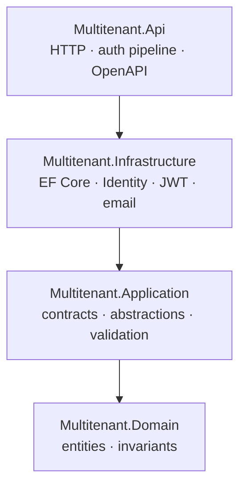

# Multitenant SaaS API


A production-minded, multi-tenant SaaS backend written in ASP.NET Core 10 and EF Core 10 on
PostgreSQL. It is the reference project for the "build a multi-tenant API" brief: tenant
isolation, JWT authentication with rotating refresh tokens, role-based authorization, user
management, project/task resources, transactional onboarding, rate limiting, health checks,
OpenAPI, structured logging and a real integration-test suite.

The domain is intentionally small (tenants, users, projects, tasks) so the interesting part
is the platform: how isolation is enforced, how auth behaves under change, and how the thing
is tested and operated.

---

## Table of contents

1. [What this project demonstrates](#what-this-project-demonstrates)
2. [Feature tour](#feature-tour)
3. [Architecture](#architecture)
4. [How multi-tenancy works](#how-multi-tenancy-works)
5. [Authentication and authorization](#authentication-and-authorization)
6. [How users are added](#how-users-are-added)
7. [API reference](#api-reference)
8. [Configuration](#configuration)
9. [Running locally](#running-locally)
10. [Testing](#testing)
11. [Docker and deployment](#docker-and-deployment)
12. [Observability](#observability)
13. [Design decisions](#design-decisions)
14. [Repository layout](#repository-layout)
15. [Known limitations and next steps](#known-limitations-and-next-steps)
16. [How this was built](#how-this-was-built)
17. [Licence](#licence)

---

## What this project demonstrates

For a reviewer, the shortest path through the codebase is:

| Skill | Where to look |
| --- | --- |
| Clean layering and dependency direction | `src/`, [ADR 0002](docs/adr/0002-layered-solution.md) |
| EF Core query filters, composite keys, interceptors | `src/Multitenant.Infrastructure/Persistence/` |
| Secure multi-tenant design | [ADR 0003](docs/adr/0003-tenant-isolation.md), `TenantIsolationTests` |
| ASP.NET Core Identity + custom JWT flows | [ADR 0004](docs/adr/0004-identity-and-tokens.md), `AuthService` |
| Refresh rotation and reuse detection | `RefreshTokenManager`, `AuthLifecycleTests` |
| Policy-based authorization | `src/Multitenant.Api/Authorization/Policies.cs` |
| RFC 7807 error modelling | `GlobalExceptionHandler`, `ProblemDetailsStatusCodePages` |
| Rate limiting and partitioning | `src/Multitenant.Api/RateLimiting/` |
| Observability and correlation | [ADR 0007](docs/adr/0007-observability.md) |
| Test strategy (unit + Testcontainers) | `tests/` |
| CI/CD to a container registry | `.github/workflows/ci.yml` |

The code favours explicit, readable implementations over clever abstractions. Every
non-obvious decision is written down.

---

## Feature tour

**Tenancy**

- Tenant provisioning in one transaction: tenant, owner account, role, starter project and
  tasks either all exist or none do.
- Two demo tenants are seeded on first run (`acme`, `globex`).
- Tenant resolution from the JWT `tenant_id` claim; no subdomain or header trust.
- Global query filters for reads, a `SaveChanges` guard for writes, a composite
  `(TenantId, ProjectId)` foreign key for referential integrity.
- Cross-tenant access returns `404`, never `403`, to avoid confirming existence.

**Identity and sessions**

- Full ASP.NET Core Identity: hashing, lockout, roles, email confirmation, TOTP two-factor.
- Custom JWT access tokens (15 minutes) and opaque rotating refresh tokens (30 days).
- Refresh-token reuse is treated as theft and revokes the whole token family.
- Role changes, logout-everywhere and password changes invalidate existing access tokens
  immediately through a live security-stamp check.
- `Auth:SingleSessionPerUser` (default `true`) limits a user to one active session; it can be
  switched off for concurrent devices.
- The same email can exist in different tenants; uniqueness is per tenant.

**Resources**

- Projects and tasks with pagination, sorting and filtering.
- Owners/Admins manage projects and users; any member can create and update tasks; deletes
  of tasks are Owner/Admin only.
- Optimistic-looking `404` behaviour on cross-tenant ids.

**Platform**

- RFC 7807 `application/problem+json` for every error, with a stable `code`, `traceId` and
  `correlationId`.
- FluentValidation with automatic validation problem responses.
- Per-tenant and per-IP rate limiting with `Retry-After`.
- `/health`, `/health/live`, `/health/ready`.
- Versioned routes (`/api/v1/...`), OpenAPI document per version and a Scalar UI.
- Serilog structured logging: readable locally, compact JSON in other environments,
  optional Application Insights sink, correlation ids end to end.
- Dockerfile, compose stack, `.env.example`, HTTP request collection and GitHub Actions CI
  that publishes to GHCR.

---

## Architecture

Four projects, one-way dependencies:



More diagrams — request pipeline, login sequence, refresh lifecycle and the ER model — live in
[docs/architecture.md](docs/architecture.md).

The API project is a composition root only. Controllers translate HTTP to Application
interfaces; all persistence and framework coupling lives in Infrastructure.

---

## How multi-tenancy works

The design assumes one database and many tenants. Isolation is enforced at five levels, so a
mistake in one layer does not become a data leak:

1. **The tenant is never a client input for authenticated calls.** `JwtBearerConfiguration`
   reads `tenant_id` from the validated token and calls `ITenantContext.SetTenant` before any
   query runs. Anonymous flows (login, refresh, registration, onboarding) resolve the tenant
   explicitly from the slug or the refresh token.
2. **Reads are filtered.** `AppUser`, `Project` and `WorkItem` carry a global EF Core query
   filter on `TenantId`. The filter references `AppDbContext.CurrentTenantId` rather than the
   injected `ITenantContext` closure, because EF caches the model per context type — a
   captured closure would freeze the first request's tenant for the process lifetime.
3. **Writes are guarded.** `TenantAuditingInterceptor` stamps new rows with the resolved
   tenant and throws if an insert, update or delete targets a different tenant. Timestamps are
   stamped in the same place.
4. **The database knows about tenancy.** `WorkItems` references `Projects` on
   `(TenantId, ProjectId)`, and `Projects` has an alternate key on `(TenantId, Id)`. A task's
   assignee is protected the same way: `(AssigneeTenantId, AssigneeUserId)` references
   `AppUser (TenantId, Id)`, and a check constraint requires `AssigneeTenantId = TenantId`.
   Cross-tenant links are therefore impossible even with direct SQL, not just through the API.
5. **The API hides existence.** A cross-tenant id produces `404` from the filtered query, not
   `403`.

Deliberate exceptions are greppable: `IgnoreQueryFilters()` only appears where a request has
no tenant context yet or where a tenant-scoped lookup must bypass the filter (login, refresh,
security-stamp validation, seeding). Each one is paired with an explicit `TenantId`
predicate.

### Why `ITenantContext` when the `DbContext` is already injected?

They answer different questions, so neither replaces the other:

- **`AppDbContext`** is how a service reads and writes data. It knows *what* a query is, not
  *who* is asking.
- **`ITenantContext`** is request-scoped ambient state: *which tenant this request belongs
  to*. It holds no data-access code.

Two cross-cutting components need the tenant **without every caller passing it down**:

1. The EF Core global query filters, which append `TenantId = ...` to tenant-owned queries.
2. The `SaveChanges` interceptor, which stamps `TenantId` on inserts and rejects writes that
   target another tenant.

Passing a `tenantId` argument into every repository method would work, but it is easy to
forget on a new query and impossible to enforce centrally. Setting it once per request (in
JWT validation, or explicitly in anonymous flows) means a forgotten parameter cannot leak
data. `AppDbContext` therefore depends on `ITenantContext`, and the filter reads
`AppDbContext.CurrentTenantId` (a `DbContext` member, not a captured service) so EF's model
cache works correctly.

The rule of thumb: **`ITenantContext` is for infrastructure that cannot be handed the tenant
explicitly; services still use `AppDbContext` for all tenant data.** There is no separate
tenant "repository" abstraction — that would be a second way to do the same query.

---

## Authentication and authorization

### Login

```http
POST /api/v1/auth/login
Content-Type: application/json

{ "tenantSlug": "acme", "email": "owner@acme.test", "password": "Demo123!Passw0rd" }
```

Returns:

```json
{
  "accessToken": "eyJhbGciOiJIUzI1NiIs...",
  "refreshToken": "uYb1...",
  "expiresIn": 900,
  "tokenType": "Bearer"
}
```

When two-factor is enabled for the user, the response instead contains
`{ "twoFactorRequired": true, "twoFactorToken": "...", "expiresIn": 300 }` and the client
continues at `/api/v1/auth/2fa/verify`.

### Access tokens

- HMAC-SHA256, issuer/audience validated, 15-minute lifetime, 30-second clock skew.
- Claims: `sub`, `tenant_id`, `tenant_slug`, `email`, `name`, `role`, `sstamp`, `jti`.
- Every request re-checks the user (exists, active, tenant active), the `sstamp` claim against
  the stored security stamp and the `role` claim against the current role. That is what makes
  role changes and "log out everywhere" immediate.

### Refresh tokens

- 256 bits of CSPRNG output, URL-safe, stored only as a SHA-256 hash.
- Single use: refreshing revokes the old token and issues a replacement in the same family.
- Presenting a revoked token revokes the whole family (reuse detection).
- `Auth:SingleSessionPerUser=true` additionally rotates the security stamp and revokes all
  other refresh tokens on login/refresh, so only the newest session survives. Set it to
  `false` for multi-device sessions.

### Roles and policies

| Role | Capabilities |
| --- | --- |
| `Owner` | Everything, including managing other Owners and the last-Owner protection |
| `Admin` | Manage users (except Owners), manage projects, delete tasks |
| `Member` | Read tenant data, create and update tasks, update own profile |

Policies are defined in `src/Multitenant.Api/Authorization/Policies.cs`:
`manage_tenant` (Owner/Admin), `owner_only`, `member` (any authenticated role). Business rules
such as "the last Owner cannot be demoted or deleted" live in `UserService`, not in
controllers.

### Email confirmation and two-factor

Both are fully implemented and disabled by default so the demo is frictionless:

| Setting | Default | Effect |
| --- | --- | --- |
| `Identity:RequireConfirmedEmail` | `false` | When `true`, unconfirmed users get `403 email_not_confirmed` |
| `Identity:EnableTwoFactor` | `false` | When `false`, 2FA endpoints return `404 feature_disabled` |

`POST /auth/2fa/setup` returns an authenticator key and `otpauth://` URI. Because Identity's
key reset rotates the security stamp, clients re-authenticate before calling
`/auth/2fa/enable` with the first TOTP code. The integration test walks exactly this flow.

Confirmation links always work, even with `Identity:RequireConfirmedEmail=false` (the flag
gates login, not the ability to confirm); resend is a no-op `202` in that mode.

Email delivery is provider-based: `Logging` writes the message to the log; `Smtp` uses MailKit
with the settings under `Email:Smtp`.

---

## How users are added

There are three supported paths:

1. **Self-service registration into an existing tenant** (anonymous, rate limited):

   ```http
   POST /api/v1/auth/register
   Content-Type: application/json

   {
     "tenantSlug": "acme",
     "email": "new-member@acme.test",
     "displayName": "New Member",
     "password": "Password1!aaaa"
   }
   ```

   The user is created as `Member`, receives a confirmation email (logged in development),
   and can log in immediately unless `Identity:RequireConfirmedEmail` is on.

   Internally this path and the admin path below call the same
   `IUserProvisioningService`, so email-uniqueness checks, Identity creation, role
   assignment and response mapping exist in one place. Only the authorization decision and
   the chosen role differ.

2. **An Owner or Admin creates a user** (authenticated). This is the path for Admins and
   Owners, and it lets the caller choose the role:

   ```http
   POST /api/v1/users
   Authorization: Bearer <access-token>
   Content-Type: application/json

   {
     "email": "another-admin@acme.test",
     "displayName": "Another Admin",
     "password": "Password1!aaaa",
     "role": "Admin"
   }
   ```

   Only an Owner can create another Owner. Members receive `403`.

3. **Tenant onboarding** creates the first Owner for a brand-new tenant
   (`POST /api/v1/tenants/onboard`), together with a starter project and three tasks.

Role changes happen through `PATCH /api/v1/users/{id}/role` and take effect on the user's
next request: their old access token immediately returns `401`, and their next refresh returns
a token carrying the new role.

---

## API reference

Base path: `/api/v1`. All timestamps are UTC. Errors are `application/problem+json`.

### Auth

| Method | Route | Auth | Purpose |
| --- | --- | --- | --- |
| POST | `/auth/login` | anonymous, IP-limited | Password login, optional 2FA challenge |
| POST | `/auth/register` | anonymous, IP-limited | Join an existing tenant as Member |
| POST | `/auth/refresh` | anonymous, IP-limited | Rotate refresh token, issue new pair |
| POST | `/auth/logout` | bearer | Revoke one refresh token |
| POST | `/auth/logout-all` | bearer | Revoke all sessions and access tokens |
| GET | `/auth/confirm-email?userId=&token=` | anonymous | Complete email confirmation |
| POST | `/auth/resend-confirmation` | anonymous, IP-limited | Re-send confirmation (always 202) |
| POST | `/auth/2fa/setup` | bearer | Create authenticator key + URI |
| POST | `/auth/2fa/enable` | bearer | Verify first code, return recovery codes |
| POST | `/auth/2fa/disable` | bearer | Verify code, disable 2FA |
| POST | `/auth/2fa/verify` | anonymous, IP-limited | Complete a 2FA login |

### Tenants

| Method | Route | Auth | Purpose |
| --- | --- | --- | --- |
| POST | `/tenants/onboard` | anonymous, IP-limited | Provision tenant + owner + starter data |
| GET | `/tenants/current` | member | Tenant resolved from the token |

### Users

| Method | Route | Auth | Purpose |
| --- | --- | --- | --- |
| GET | `/users/me` | member | Current profile |
| GET | `/users` | Owner/Admin | Paged list (`page`, `pageSize`, `sort`, `search`, `role`, `isActive`) |
| GET | `/users/{id}` | Owner/Admin | One user in the current tenant |
| POST | `/users` | Owner/Admin | Create user with a role |
| PATCH | `/users/{id}/role` | Owner/Admin | Change role (invalidates access tokens) |
| DELETE | `/users/{id}` | Owner/Admin | Delete user (last-Owner protection) |

### Projects

| Method | Route | Auth | Purpose |
| --- | --- | --- | --- |
| GET | `/projects` | member | Paged list (`search`, `status`, `sort`) |
| GET | `/projects/{id}` | member | One project |
| POST | `/projects` | Owner/Admin | Create |
| PUT | `/projects/{id}` | Owner/Admin | Update |
| DELETE | `/projects/{id}` | Owner/Admin | Delete (cascades to tasks) |

### Tasks

| Method | Route | Auth | Purpose |
| --- | --- | --- | --- |
| GET | `/tasks` | member | Paged list (`search`, `status`, `priority`, `projectId`, `assigneeUserId`, `dueBefore`, `dueAfter`, `sort`) |
| GET | `/tasks/{id}` | member | One task |
| GET | `/projects/{projectId}/tasks` | member | Tasks of one project |
| POST | `/projects/{projectId}/tasks` | member | Create task (any member) |
| PUT | `/tasks/{id}` | member | Update task |
| DELETE | `/tasks/{id}` | Owner/Admin | Delete task |

Sorting uses `field` for ascending and `-field` for descending, restricted to a per-resource
whitelist. Page size is capped at 100.

### Platform

| Route | Purpose |
| --- | --- |
| `GET /health` | All checks |
| `GET /health/live` | Liveness only |
| `GET /health/ready` | Database readiness |
| `GET /openapi/v1.json` | OpenAPI document for v1 |
| `GET /scalar` | Scalar API explorer |

There is also a complete request collection at
[`src/Multitenant.Api/Multitenant.Api.http`](src/Multitenant.Api/Multitenant.Api.http) which
works in Rider, Visual Studio and VS Code (REST Client).

---

## Configuration

Configuration is standard ASP.NET Core: `appsettings.json`, then
`appsettings.{Environment}.json`, then environment variables (use `__` for `:`).

| Key | Default | Notes |
| --- | --- | --- |
| `ConnectionStrings:Postgres` | empty | Required at runtime. Npgsql connection string |
| `ForwardedHeaders:Enabled` | `false` | Trust `X-Forwarded-For`/`X-Forwarded-Proto` from a proxy |
| `ForwardedHeaders:ForwardLimit` | `1` | Number of proxies in front of the API |
| `ForwardedHeaders:KnownProxies` | `[]` | Proxy IPs allowed to set forwarding headers |
| `ForwardedHeaders:KnownNetworks` | `[]` | Proxy networks in CIDR form, e.g. `10.0.0.0/8` |
| `Jwt:Issuer` | `multitenant-aspnet-api` | Validated on every token |
| `Jwt:Audience` | `multitenant-aspnet-api` | Validated on every token |
| `Jwt:SigningKey` | empty | **Required.** Minimum 32 characters |
| `Jwt:AccessTokenMinutes` | `15` | 1–120 |
| `Auth:SingleSessionPerUser` | `true` | New login/refresh invalidates older sessions |
| `Auth:RefreshTokenDays` | `30` | Refresh-token lifetime |
| `Auth:PublicBaseUrl` | `http://localhost:8080` | Used to build confirmation links |
| `Auth:TwoFactorChallengeMinutes` | `5` | Lifetime of the 2FA challenge token |
| `Identity:RequireConfirmedEmail` | `false` | Block login until email confirmed |
| `Identity:EnableTwoFactor` | `false` | Expose and require TOTP |
| `Email:Provider` | `Logging` | `Logging` or `Smtp` |
| `Email:FromAddress` | `no-reply@multitenant.local` | Sender address |
| `Email:FromName` | `Multitenant API` | Sender name |
| `Email:Smtp:Host` | empty | Required when provider is `Smtp` |
| `Email:Smtp:Port` | `587` | |
| `Email:Smtp:UseStartTls` | `true` | |
| `Email:Smtp:Username` / `Password` | empty | Optional SMTP auth |
| `RateLimiting:Tenant:PermitLimit` | `120` | Requests per window per tenant |
| `RateLimiting:Tenant:WindowSeconds` | `60` | |
| `RateLimiting:Auth:PermitLimit` | `10` | Requests per window per IP |
| `RateLimiting:Auth:WindowSeconds` | `60` | |
| `Database:AutoMigrate` | `false` | Apply migrations on startup (dev/demo) |
| `Database:SeedDemoData` | `false` | Seed roles + `acme`/`globex` |
| `Demo:Password` | empty | Password for seeded demo users |
| `Cors:AllowedOrigins` | `[]` | Empty disables CORS |
| `Serilog:MinimumLevel:*` | `Information` | Standard Serilog overrides |
| `Serilog:AzureMonitor:ConnectionString` | empty | When set, also logs to Application Insights |

Development values live in `src/Multitenant.Api/appsettings.Development.json`; production
values should come from environment variables or a secret store. `Jwt:SigningKey`,
`ConnectionStrings:Postgres` and `Demo:Password` are intentionally empty in
`appsettings.json`.

---

## Running locally

### Prerequisites

- .NET SDK 10.0.4xx (the repository pins `10.0.401` in `global.json`, `rollForward:
  latestFeature`)
- PostgreSQL 16, or Docker Desktop
- Optional: `dotnet-ef` (`dotnet tool install --global dotnet-ef --version 10.*`)

### Option A — Docker Compose (one command)

```bash
cp .env.example .env       # edit JWT_SIGNING_KEY and passwords
docker compose up --build
```

The API waits for PostgreSQL, applies migrations and seeds demo data (Development defaults),
then listens on <http://localhost:8080>. Scalar is at <http://localhost:8080/scalar>.

### Option B — local `dotnet run` with your own PostgreSQL

1. Create a database and point the connection string at it. The default Development value is:

   ```text
   Host=localhost;Port=5432;Database=multitenantDb;Username=multitenant-DbUser;Password=multitenant-DbPassword123!
   ```

   You can override it without editing the file:

   ```bash
   export ConnectionStrings__Postgres="Host=localhost;Port=5432;Database=multitenantDb;Username=postgres;Password=postgres"
   export Jwt__SigningKey="<32+ character random string>"
   ```

2. Run:

   ```bash
   dotnet run --project src/Multitenant.Api
   ```

   In Development `Database:AutoMigrate` and `Database:SeedDemoData` are `true`, so the schema
   and demo tenants are created automatically. The HTTP profile listens on
   <http://localhost:5270>; the `https` profile also exposes <https://localhost:7073>.

3. Open <http://localhost:5270/scalar> or the raw document at
   <http://localhost:5270/openapi/v1.json>.

### Demo accounts

Both tenants use the password `Demo123!Passw0rd` (configurable through `Demo:Password`):

| Tenant | Email | Role |
| --- | --- | --- |
| `acme` | `owner@acme.test` | Owner |
| `acme` | `member@acme.test` | Member |
| `globex` | `owner@globex.test` | Owner |
| `globex` | `member@globex.test` | Member |

### Migrations

```bash
# Add a migration (design-time factory is in Infrastructure)
dotnet ef migrations add <Name> \
  --project src/Multitenant.Infrastructure \
  --startup-project src/Multitenant.Infrastructure \
  --output-dir Persistence/Migrations

# Apply manually
dotnet ef database update \
  --project src/Multitenant.Infrastructure \
  --startup-project src/Multitenant.Infrastructure
```

The design-time factory reads `ConnectionStrings__Postgres` from the environment, then the
API's `appsettings*.json`, then falls back to the Development connection string.

### Try it

```bash
# Log in
curl -s http://localhost:5270/api/v1/auth/login \
  -H "Content-Type: application/json" \
  -d '{"tenantSlug":"acme","email":"owner@acme.test","password":"Demo123!Passw0rd"}'

# Use the access token
curl -s http://localhost:5270/api/v1/tenants/current \
  -H "Authorization: Bearer <access-token>"

# Onboard a new tenant
curl -s http://localhost:5270/api/v1/tenants/onboard \
  -H "Content-Type: application/json" \
  -d '{"slug":"initech","name":"Initech","ownerEmail":"owner@initech.test","ownerDisplayName":"Initech Owner","ownerPassword":"Password1!aaaa"}'
```

---

## Testing

```bash
dotnet test multitenant-aspnet-api.slnx
```

**Unit tests** (`tests/Multitenant.UnitTests`, 32 tests) cover domain invariants (slug and
password rules), pagination/sorting (including offset overflow), claim generation, 2FA
challenge validation and refresh token hashing. They run in milliseconds and need no
infrastructure.

**Integration tests** (`tests/Multitenant.IntegrationTests`, 50 tests) boot the real API with
`WebApplicationFactory<IApiMarker>` against a real PostgreSQL 16 container managed by
Testcontainers. They cover:

- tenant isolation for projects, tasks and users, including cross-tenant writes;
- cross-tenant assignee rejection;
- refresh rotation, reuse detection and family revocation, expiry and concurrent rotation;
- single-session enforcement and the multi-device (`SingleSessionPerUser=false`) path;
- role-change invalidation and refreshed role claims;
- logout, logout-all and account lockout after repeated bad passwords;
- registration, duplicate email handling, Member restrictions and the Owner/Admin matrix;
- email confirmation end-to-end (captured email) and resend behaviour;
- two-factor enable, login challenge, recovery-code single use and disable;
- paging, sorting, search and status/priority/date filters;
- per-IP and per-tenant rate limiting, including tenant isolation and health exemptions;
- startup configuration validation (JWT key, email provider, forwarded proxies);
- health checks, OpenAPI (including the bearer scheme), validation errors, 404/405,
  correlation ids and problem-details shape.

Docker must be running for the integration suite. The collection fixture starts one container
per run and shares it across tests; each test uses unique tenant slugs so tests do not collide.

Run one suite or one test:

```bash
dotnet test tests/Multitenant.UnitTests
dotnet test tests/Multitenant.IntegrationTests --filter "FullyQualifiedName~TenantIsolation"
```

---

## Docker and deployment

The `Dockerfile` is multi-stage and runs as the non-root `$APP_UID` user on
`mcr.microsoft.com/dotnet/aspnet:10.0`. It copies `Directory.Build.props` and `global.json`
before restoring so the container build matches local builds.

`compose.yaml` starts PostgreSQL with a health check and the API with:

```yaml
ASPNETCORE_ENVIRONMENT: Development
Jwt__SigningKey: ${JWT_SIGNING_KEY:?...}
Database__AutoMigrate: "true"
Database__SeedDemoData: "true"
```

Production deployments should:

- set `Database:AutoMigrate=false` and run migrations as a release step;
- set `Database:SeedDemoData=false`;
- provide `ConnectionStrings__Postgres` and `Jwt__SigningKey` from the platform secret store;
- terminate TLS at the ingress/reverse proxy (the app serves plain HTTP on 8080);
- enable `ForwardedHeaders` and list the ingress proxies/networks so per-IP rate limiting
  and logs see the real client address;
- use the `Smtp` email provider (or add a provider-specific `IEmailSender`);
- run at least two replicas behind a load balancer.

### CI/CD

`.github/workflows/ci.yml` has two jobs:

1. **build-test** — restore, Release build, unit tests, integration tests (GitHub-hosted
   Ubuntu runners provide Docker for Testcontainers), upload TRX artefacts.
2. **publish-image** — on pushes to `main`/`master` and on `v*.*.*` tags, builds and pushes
   `ghcr.io/<owner>/<repo>` using GitHub Container Registry, with branch, SHA, semver and
   `latest` tags.

The intended release tag is **`v1.0.0`**, which produces container tags `1.0.0` and `1.0`.

To enable the image, keep the workflow's default `GITHUB_TOKEN` permissions as declared
(`packages: write`) or add a `CR_PAT`. No repository secrets are required for tests.

---

## Observability

- **Correlation**: every request has an `X-Correlation-Id` (accepted or generated), echoed in
  the response, added to Serilog's context and included in problem details as
  `correlationId`; ASP.NET's `traceId` is included too.
- **Request logging**: Serilog request completion logs include method, path, status and
  elapsed time.
- **Development**: human-readable console template.
- **Other environments**: compact JSON on stdout. That is directly ingestible by CloudWatch
  Logs (via the CloudWatch agent / FireLens) and Azure Log Analytics (via the Azure Monitor
  agent).
- **Azure Application Insights**: set `Serilog:AzureMonitor:ConnectionString` and the same
  events are also sent to App Insights, where they are queryable with KQL in Azure Monitor /
  Log Insights.
- **Errors**: handled exceptions are logged at Warning, unhandled at Error with the exception;
  no stack traces are returned to clients outside Development.

Example CloudWatch Logs Insights query:

```sql
fields @timestamp, @message
| filter Application = "Multitenant.Api" and @message like /Unhandled/
| sort @timestamp desc
```

---

## Design decisions

- [0001 — Record architecture decisions](docs/adr/0001-record-architecture-decisions.md)
- [0002 — Layered solution with a thin API](docs/adr/0002-layered-solution.md)
- [0003 — Tenant isolation in one database](docs/adr/0003-tenant-isolation.md)
- [0004 — Identity with custom JWTs and rotating refresh tokens](docs/adr/0004-identity-and-tokens.md)
- [0005 — Email confirmation and 2FA are opt-in](docs/adr/0005-identity-feature-flags.md)
- [0006 — Per-tenant rate limiting](docs/adr/0006-rate-limiting.md)
- [0007 — Structured logging and RFC 7807 errors](docs/adr/0007-observability.md)

---

## Repository layout

```text
.
├── .github/workflows/ci.yml           build, test, publish to GHCR
├── .env.example                       compose environment template
├── compose.yaml                       PostgreSQL + API for local runs
├── Directory.Build.props              shared compiler/analyser settings
├── global.json                        SDK pin
├── multitenant-aspnet-api.slnx
├── docs/
│   ├── architecture.md                diagrams: context, pipeline, ER, refresh states
│   └── adr/                           architecture decision records
├── src/
│   ├── Multitenant.Api/               controllers, middleware, filters, rate limiting, Program
│   ├── Multitenant.Application/
│   │   ├── Abstractions/              one interface per file
│   │   │   ├── Identity/              auth, JWT, current user, account email
│   │   │   ├── Messaging/             IEmailSender + EmailMessage
│   │   │   └── Tenancy/               tenant context + tenant/user/project/task services
│   │   ├── Common/                    paging, sorting, password policy, claim names
│   │   ├── Configuration/             one options class per file, grouped by section
│   │   ├── Contracts/                 one DTO per file, grouped by feature
│   │   ├── Errors/                    AppException + one file per exception
│   │   └── Validation/                one validator per file, grouped by feature
│   ├── Multitenant.Domain/            entities and invariants (one type per file)
│   └── Multitenant.Infrastructure/
│       ├── Email/                     logging + SMTP senders
│       ├── Identity/                  AuthService, token manager, provisioning, JWT setup
│       ├── Persistence/               DbContext, interceptor, initializer, migrations
│       ├── Services/                  tenant, user, project and task services
│       └── Tenancy/                   TenantContext
└── tests/
    ├── Multitenant.UnitTests/         fast domain/unit coverage
    └── Multitenant.IntegrationTests/  WebApplicationFactory + Testcontainers
```

**Conventions**

- One public type per file, named after the type.
- Folders describe a feature or concern and **namespaces mirror the folders**
  (`Multitenant.Application.Contracts.Auth`, `Multitenant.Application.Configuration.Jwt`),
  so a file's location is predictable from its `using` and namespaces never drift from the
  directory tree.
- Interfaces live in `Application/Abstractions`; implementations live in `Infrastructure`.
  `Multitenant.Api` contains no business logic.
- There is one way to do each thing: one tenant context, one user-creation path, one
  problem-details factory, one password policy and one tenant-slug rule.

Migrations live in `src/Multitenant.Infrastructure/Persistence/Migrations`.

---

## Known limitations and next steps

These are deliberate scope cuts, not oversights:

- **Registration by slug** lets anyone who knows a tenant slug join as a Member. A production
  system would use signed invites (email domain allow-lists or an Owner-issued token). The
  admin path (`POST /users`) is already constrained; this is the one open door.
- **Refresh tokens are not garbage-collected.** Expired rows accumulate; a scheduled cleanup
  or a retention job is needed.
- **Rate limiting is in-process.** With multiple replicas the effective limit is per replica;
  a Redis-backed limiter is the next step.
- **Permissions are role-based, not per-resource.** A future iteration could add fine-grained
  policies (for example, project-scoped membership).
- **No audit trail table.** Security events are logged but not persisted as domain records.
- **Email templates are inline strings**, not a templating system.

---

## How this was built

This repository was built by its author with **AI-assisted development**. Pairing with AI
agents was used for scaffolding, drafting and reviewing code, writing tests and documentation,
and iterating on design trade-offs — the same way one might pair with a senior colleague. The
requirements, architecture decisions, review and final judgement were driven by the author;
the ADRs and this README record the reasoning so it can be scrutinised on its merits.

The goal of documenting that openly is simple: the interesting question for a reviewer is
whether the result is understandable, tested and defensible. Read the ADRs, run the tests,
and judge the code.

---

## Licence

[MIT](LICENSE)
