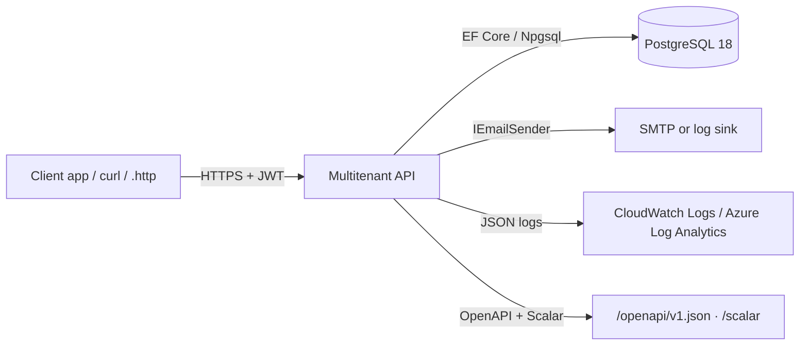
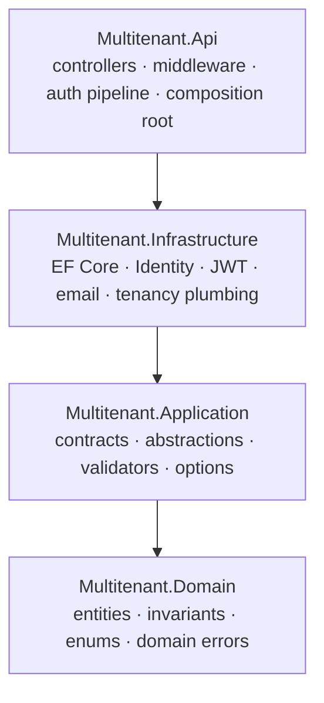
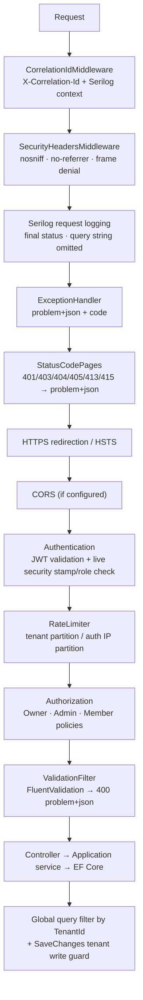
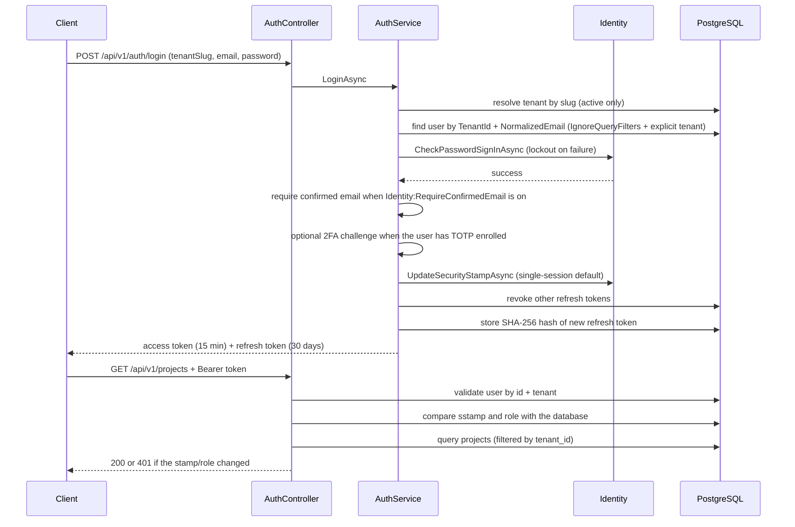
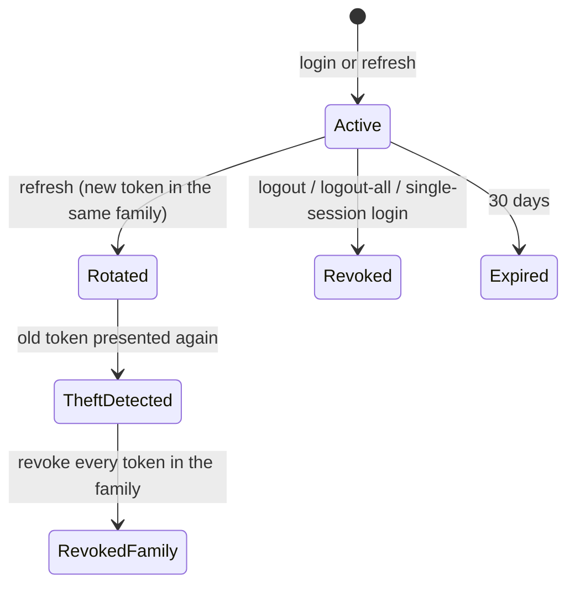
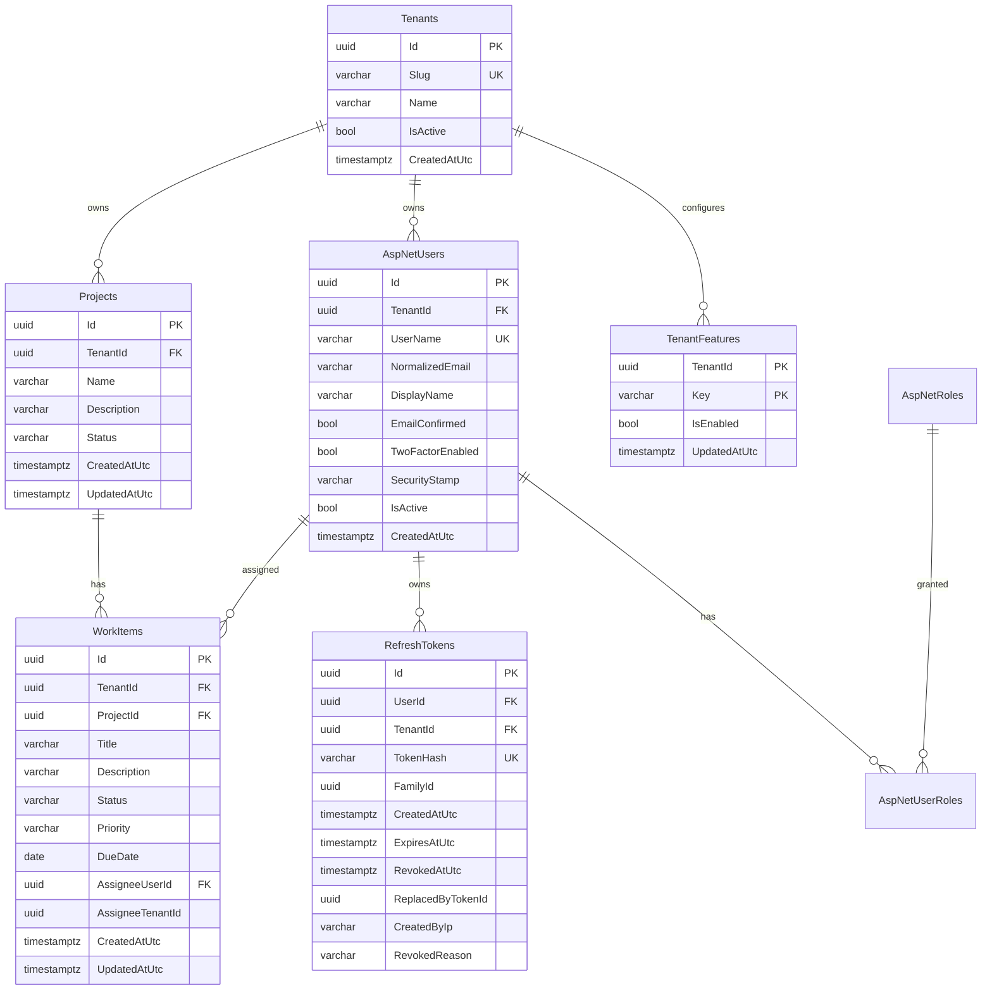

# Architecture

This document describes the system as it is today. Decisions and their rationale live in
`docs/adr/`; the product-level walkthrough and endpoint reference live in `README.md`.

## System context

## Layers and dependency direction

## Request pipeline

## Login and request-time validation

Two ordering rules matter here:

- The email-confirmation check runs **after** the password, so `403 email_not_confirmed`
  cannot be used to enumerate addresses.
- The tenant context is set before password verification, because a failed attempt writes
  lockout counters and the write guard needs a resolved tenant.

## Refresh-token rotation

A refresh is rejected when the flag `Identity:RequireConfirmedEmail` is on and the account is
still unconfirmed, so sessions minted before the flag was enabled cannot outlive it.

## Tenant isolation

Three layers, each independent of the others:

1. **Read** — EF Core global query filters on `AppUser`, `Project` and `WorkItem`. The filter
   reads `AppDbContext.CurrentTenantId` (a `DbContext` property, not a captured service), so
   EF's model cache stays valid.
2. **Tracked writes** — `TenantAuditingInterceptor` stamps `TenantId` on inserts, rejects writes
   whose tenant differs from the resolved one, and rejects `TenantId` changes after insert.
   Set-based refresh-token revocation carries an explicit `TenantId`; retention is deliberately
   global.
3. **Referential** — composite foreign keys on `(TenantId, Id)` for projects, task assignees and
   refresh tokens, plus `CK_WorkItems_AssigneeTenant`, which requires both assignee columns to be
   set together (the composite FK is MATCH SIMPLE, so a NULL would otherwise skip the check).

Cross-tenant reads and writes return **404**, never 403, so the API does not confirm that a
resource exists in another tenant.

## Data model

`AspNetRoleClaims`, `AspNetUserClaims`, `AspNetUserLogins`, `AspNetUserTokens` and
`AspNetUserPasskeys` are the standard Identity tables and are omitted for readability.
`AspNetUsers` and `Projects` also carry a unique alternate key on `(TenantId, Id)` so
`WorkItems` and `RefreshTokens` can reference them with composite foreign keys. `Projects` and
`WorkItems` use PostgreSQL's existing `xmin` system column as an optimistic-concurrency token;
it is not a physical application column.

Schema is created by the migrations in `Persistence/Migrations` (`InitialCreate`, then
`TenantFeatures`, `RefreshTokenIntegrityAndRetention` and the no-DDL `OptimisticConcurrencyTokens`
model update), applied automatically when `Database:AutoMigrate` is on. Demo data is seeded
separately by `DatabaseInitializer` only when `Database:SeedDemoData` is on; roles are always
ensured.

## Where to look

| Concern | File |
| --- | --- |
| Tenant resolution + live token checks | `src/Multitenant.Infrastructure/Identity/JwtBearerConfiguration.cs` |
| Query filters and model configuration | `src/Multitenant.Infrastructure/Persistence/AppDbContext.cs` |
| Write guard + timestamp stamping | `src/Multitenant.Infrastructure/Persistence/TenantAuditingInterceptor.cs` |
| Pessimistic tenant-row serialization | `src/Multitenant.Infrastructure/Persistence/TenantRowLock.cs` |
| Login, refresh, 2FA, registration | `src/Multitenant.Infrastructure/Identity/AuthService.cs` |
| User creation (registration + admin) | `src/Multitenant.Infrastructure/Identity/UserProvisioningService.cs` |
| Refresh token hashing/rotation helpers | `src/Multitenant.Infrastructure/Identity/RefreshTokenManager.cs` |
| Tenant onboarding transaction | `src/Multitenant.Infrastructure/Services/TenantService.cs` |
| Per-tenant feature switches | `src/Multitenant.Infrastructure/Services/TenantFeatureService.cs` |
| User/role rules (last-Owner guard) | `src/Multitenant.Infrastructure/Services/UserService.cs` |
| Error contract | `src/Multitenant.Api/Middleware/GlobalExceptionHandler.cs` |
| Rate limiting | `src/Multitenant.Api/RateLimiting/RateLimitingSetup.cs` |
| Demo seeding | `src/Multitenant.Infrastructure/Persistence/DatabaseInitializer.cs` |
